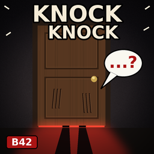

# Knock Knock



**[Get it on the Steam Workshop](https://steamcommunity.com/sharedfiles/filedetails/?id=3835665444)**

A **Project Zomboid Build 42** mod that lets you knock on closed doors and tap on windows to hear if something is waiting on the other side.

Zombies inside may answer with thumps on the door. Or they may stay silent... and silence isn't always proof the room is empty.

## Features

- **Four ways to knock**
  | Mode | How | Noise | Who can hear |
  |------|-----|-------|--------------|
  | Soft knock | Door, default action | 1x radius | Zombies in the room behind the door |
  | Bang | Door + Shift, bare hands | 2.5x radius | The whole building |
  | Weapon bang | Door + Shift, weapon in hand | 3x radius | The whole building (25% chance to cost 1 weapon condition) |
  | Tap | Window (closed, not smashed) | 0.7x radius | Zombies in the room behind the window |
- **Answers you can hear**: up to 3 thumps from the other side, and your character comments on what they heard ("Silence. Probably empty.", "That's a crowd. Nope.").
- **Traits matter**: *Keen Hearing* gives you a rough count, *Hard of Hearing* sometimes leaves you unsure.
- **Fear and relief**: a crowd answering raises panic, silence lowers stress a little.
- **Sneaking XP** for a quiet knock or tap that nothing answers.
- **Character voice reactions** using the game's own sighs and tsks.
- **Knocking is noise**: zombies inside and nearby may come to the door.
- **Custom sounds** for knock, bang, tap and thump.

## How to use

- **Right-click** a closed door or window and choose *Knock softly*, *Bang on door* or *Tap on window*.
- Or press **K** near a door or window. Hold **Shift+K** to bang.
- Your character walks to your side of the door first, then knocks.
- Doors on the edge of a building say *"That leads outside."*: there's nothing to hear.

## Mod options

Found in **Options > Mods > Knock Knock**.

| Option | Default | What it does |
|--------|---------|--------------|
| Knock key | `K` | Hotkey for knocking (hold Shift to bang) |
| Answer chance (%) | 75 (50 to 100) | How often each zombie inside reacts. Lower = silence is less trustworthy |
| Zombies hear my knock | On | Knocking makes noise that can attract zombies |
| Soft knock noise radius | 6 tiles (2 to 15) | How far a soft knock carries |
| Fear reactions | On | Panic from crowds, relief from silence |
| Sneaking XP | On | XP for unanswered soft knocks and taps |
| Character voice reactions | On | Short voice sound when your character reacts |

## Installation

**From Steam Workshop:** subscribe to [*[B42] Knock Knock*](https://steamcommunity.com/sharedfiles/filedetails/?id=3835665444), then enable it in **Mods** from the main menu.

**Manually:** copy `Contents/mods/KnockKnock` into `C:\Users\<you>\Zomboid\mods\`, then enable it in **Mods**.

Requires **Build 42.0.0 or later**. The code handles the trait and stat changes from B42.13, so it works on older and newer B42 versions.

## Project structure

The folder layout follows the Steam Workshop format that Project Zomboid expects, so it must stay as it is. The game only reads what's inside `Contents/mods/`.

```
KnockKnock/
├── README.md                     # this file
├── preview.png                   # Steam Workshop thumbnail
├── workshop.txt                  # Workshop title, description, tags, visibility
└── Contents/mods/KnockKnock/42/  # the mod itself (42 = Build 42)
    ├── mod.info                  # mod ID, name, minimum game version
    ├── poster.png                # image in the in-game mod list
    └── media/
        ├── lua/client/
        │   ├── KnockKnock.lua         # core: options, knock modes, answers, fear, XP, right-click menu
        │   ├── KnockKnock_Action.lua  # timed action: animation, sound, duration
        │   └── KnockKnock_Key.lua     # hotkey: finds the nearest door or window
        ├── scripts/
        │   └── KnockKnock_sounds.txt  # sound definitions
        └── sound/                     # Knock, Bang, Tap, Thump (.ogg)
```

## How it works

1. You pick a door or window (menu or hotkey). The mod works out which side you're on and walks you there.
2. A timed action plays the knock animation and sound (`ISKnockDoorAction`).
3. If enabled, the knock makes in-game noise that zombies can hear (`addSound`).
4. The mod looks at the square on the **far side**. If it isn't inside a building, it's an outside door.
5. Each living zombie in that building (or just that room, for soft knocks and taps) rolls against the answer chance. Bangs add a bonus, and zombies on other floors hear half as well.
6. After a short pause the thumps play and your character reacts, with the trait, fear and XP effects above.
